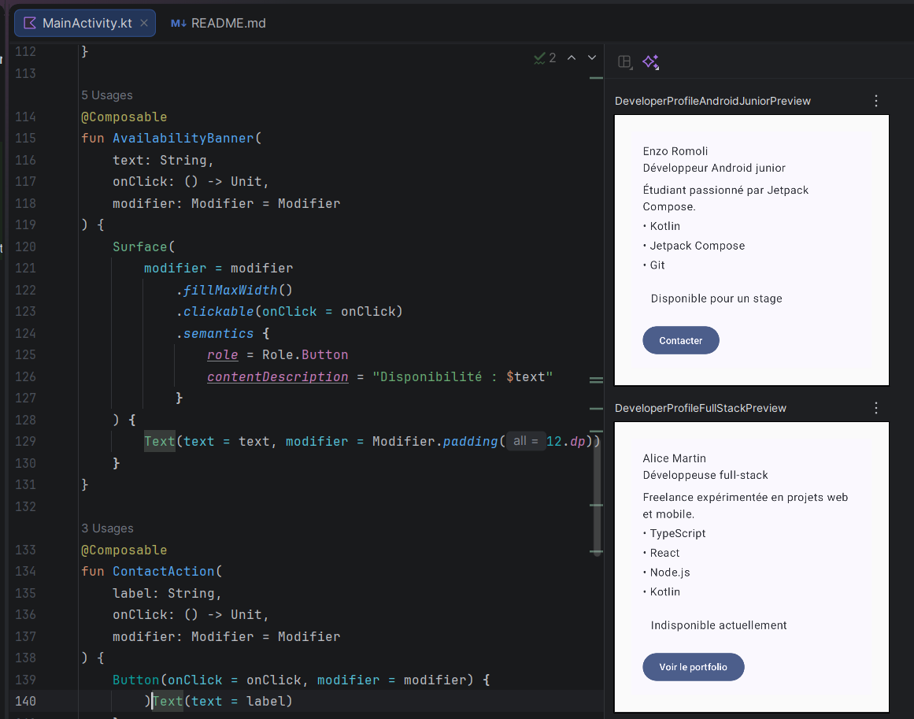

# Profil développeur Compose

## Description courte

Cet écran Jetpack Compose affiche une fiche « Profil développeur » contenant un nom, un rôle, une courte description, une liste de compétences, une information de disponibilité cliquable et un bouton d'action. L'interface est découpée en plusieurs composables réutilisables acceptant un `Modifier`.

## Notions utilisées

- composables
- paramètres
- modifiers et chaînage de modifiers
- padding externe / interne
- callbacks
- previews
- accessibilité de base (`semantics`, `Role.Button`, `contentDescription`)

## Explication courte

1. **Composables créés** : `DeveloperProfileScreen`, `DeveloperProfileCard`, `ProfileHeader`, `ProfileDescription`, `SkillItem`, `AvailabilityBanner`, `ContactAction`.
2. **Écran principal** : `DeveloperProfileScreen`.
3. **Padding externe** : appliqué par le parent via `modifier.padding(24.dp)` dans `DeveloperProfileScreen` pour placer la carte dans l'écran, et via `Modifier.padding(top = ...)` pour espacer les composants enfants dans la `Column` de `DeveloperProfileCard`.
4. **Padding interne** : appliqué à l'intérieur de `DeveloperProfileCard` (`Modifier.padding(16.dp)` sur la `Column`) et de `AvailabilityBanner` (`Modifier.padding(12.dp)` autour du texte).
5. **Composant qui reçoit un callback** : `ContactAction` (callback `onClick`) et `AvailabilityBanner` (callback `onClick`).
6. **Information d'accessibilité** : `AvailabilityBanner` associe `Role.Button` et un `contentDescription` à sa zone cliquable personnalisée via `semantics`.
7. **Réutilisabilité** : chaque composable reçoit ses données en paramètres et accepte un `modifier: Modifier = Modifier`, ce qui permet de l'appeler avec des contenus différents et de laisser le parent décider du placement externe.

## Previews

Deux previews sont fournies : `DeveloperProfileAndroidJuniorPreview` (profil Android junior disponible) et `DeveloperProfileFullStackPreview` (profil full-stack indisponible).

## Capture

