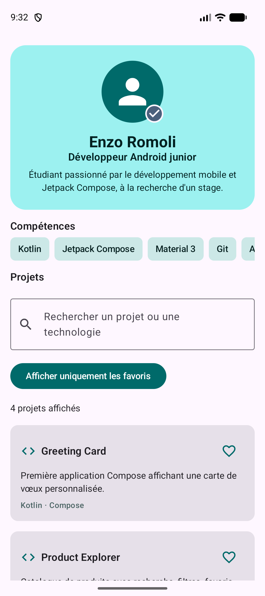

# Profil développeur interactif

## Description

Évolution de l'application « Profil développeur » en petit portfolio interactif. En plus du profil (avatar, nom, rôle, description, compétences, contact), l'utilisateur peut :

- rechercher un projet par son titre, sa description ou une technologie (ex. « Kotlin », « StateFlow ») ;
- ajouter ou retirer un projet des favoris (icône cœur sur chaque carte) ;
- afficher tous les projets ou uniquement les favoris ;
- voir le nombre de projets affichés (« 4 projets affichés », « 1 projet affiché ») ;
- afficher ou masquer les informations de contact.

Toutes les données restent locales (`data/SampleProfile.kt`).

## États gérés par l'application

État principal, dans `ProfileUiState` (géré par le ViewModel) :

- `searchQuery` : texte de recherche ;
- `showOnlyFavorites` : filtre « favoris uniquement » ;
- `favoriteProjectIds` : identifiants des projets favoris ;
- `projects` : liste des projets affichés, recalculée à chaque action ;
- `profile` : les informations du développeur à afficher.

État local, dans `ContactSection` :

- `showContactInfo` : informations de contact affichées ou masquées.

## État local

L'affichage des informations de contact (`showContactInfo`) est gardé directement dans le composable `ContactSection` avec `rememberSaveable`. C'est un simple état d'interface : il ne concerne que cette carte, aucun autre composant n'en a besoin et il n'a aucun lien avec les données des projets. Le remonter dans le ViewModel n'apporterait rien. `rememberSaveable` permet de le conserver lors d'une rotation de l'écran.

## State Hoisting

`ProfileScreen` est stateless : il ne contient ni `remember`, ni `mutableStateOf`, ni ViewModel. Il reçoit tout ce qu'il affiche en paramètres (`profile`, `projects`, `searchQuery`, `showOnlyFavorites`, `favoriteProjectIds`) et signale les actions de l'utilisateur par des callbacks (`onSearchQueryChange`, `onToggleFavoriteFilter`, `onFavoriteClick`, `onContactClick`). Il ne décide pas où ni comment l'état est stocké, ce qui permet aussi de l'afficher dans les previews avec des valeurs fixes.

## ViewModel

`ProfileViewModel` possède l'état principal de l'écran et contient la logique des actions : modifier la recherche, activer ou désactiver le filtre favoris, ajouter ou retirer un favori. Après chaque action, il recalcule la liste des projets affichés (fonction privée `filterProjects`) et publie un nouvel état. Il conserve aussi cet état quand l'écran est recréé, par exemple lors d'une rotation.

## StateFlow

Le ViewModel garde l'état dans un `MutableStateFlow` privé (`_uiState`) et n'expose qu'une version en lecture seule (`uiState: StateFlow<ProfileUiState>`). À chaque action, il crée une nouvelle copie de l'état avec `_uiState.update { it.copy(...) }`. `ProfileContainer` observe ce flux avec `collectAsState()` : dès qu'un nouvel état est publié, Compose le reçoit et recompose l'écran avec les nouvelles valeurs.

## Organisation du code

- `ProfileViewModel` : possède l'état principal et réagit aux actions de l'utilisateur.
- `ProfileUiState` : classe qui regroupe tout l'état de l'écran.
- `ProfileContainer` : récupère le ViewModel, collecte le `StateFlow` et transmet valeurs et callbacks à l'écran.
- `ProfileScreen` : écran stateless qui affiche le profil, la recherche, le filtre, le compteur et la liste.
- `ProjectCard` : carte réutilisable d'un projet avec son bouton favori.
- `ContactSection` : carte de contact avec son état local d'affichage.
- `ProfileHeader`, `ProfileAvatar`, `SkillsSection`, `SkillChip`, `ContactField` : composants d'affichage réutilisables.

Previews (dans `ProfileScreen.kt`, sur l'écran stateless) :

- `ProfileScreenAllProjectsPreview` : thème clair, recherche vide, tous les projets, aucun favori ;
- `ProfileScreenFavoritesSearchPreview` : thème sombre, recherche « Kotlin », filtre favoris activé, deux projets favoris.

## Capture d'écran

