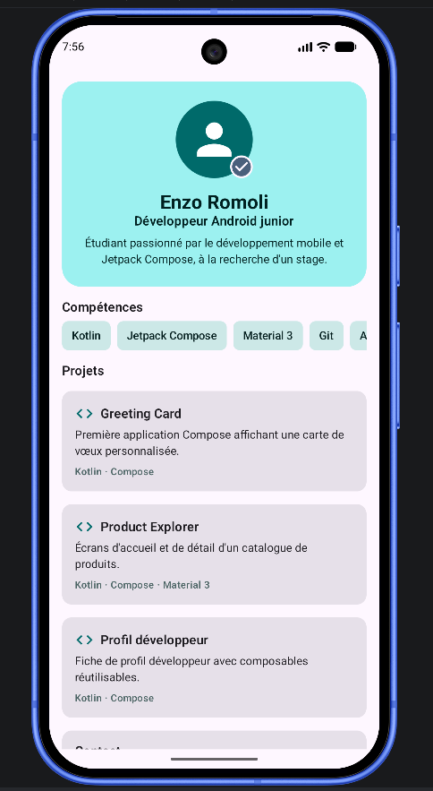

# Profil développeur — Amélioration UI

## Description

Évolution de l'application « Profil développeur » : un écran de profil plus complet et plus professionnel construit avec Jetpack Compose et Material Design 3. Il affiche un avatar avec un badge de disponibilité, le nom, le rôle, une description, une liste de compétences, une liste de projets et une zone de contact avec un bouton « Contacter ». Toutes les données sont locales (`data/SampleProfile.kt`).

## Composants Compose utilisés

- `Text` : nom, rôle, description, titres de sections, projets.
- `Button` : action principale « Contacter » (`ContactSection`).
- `Icon` : badge de disponibilité, icône des projets, icônes des champs de contact et du bouton.
- `Image` : avatar placeholder (`ProfileAvatar`).
- `Card` : `ProjectCard` et `ContactSection`.
- `OutlinedTextField` en lecture seule : email et localisation (`ContactField`).

## Layouts utilisés

- `Column` : structure verticale de l'en-tête, des cartes et des sections.
- `Row` : icône et titre d'un projet sur la même ligne.
- `Box` : avatar avec badge de disponibilité superposé.
- `Spacer` : espacements entre les éléments.
- `Surface` : en-tête du profil (`primaryContainer`) et `SkillChip` (`secondaryContainer`).

## Listes

- `LazyColumn` : conteneur de l'écran `DeveloperProfileScreen`. Chaque projet est affiché avec le composable réutilisable `ProjectCard` via `items(profile.projects, key = { it.title })`.
- `LazyRow` : liste horizontale des compétences dans `SkillsSection`, chaque compétence affichée avec `SkillChip`.

## Choix de thème

Le thème `DeveloperProfileTheme` (`ui/theme/`) définit :

- `colorScheme` : palette sarcelle (teal) personnalisée, une version claire et une version sombre, sans couleurs dynamiques pour garder une identité visuelle constante.
- `typography` : `headlineSmall` en gras pour le nom et `titleMedium` en semi-gras pour les titres de sections.
- `shapes` : coins arrondis `small` (chips), `medium` (cartes) et `large` (en-tête).

Le mode clair ou sombre suit le réglage du système (`isSystemInDarkTheme()`). Deux previews montrent les deux rendus : `DeveloperProfileScreenLightPreview` et `DeveloperProfileScreenDarkPreview`.

## Capture d'écran

## Quelles notions du chapitre Compose UI avez-vous réutilisées dans cette application ?

Les composants fondamentaux (`Text`, `Button`, `Icon`, `Image`, `Card`, `OutlinedTextField` en lecture seule), les layouts (`Column`, `Row`, `Box`, `Spacer`, `Surface`), les listes modernes (`LazyColumn`, `LazyRow`) avec des composables réutilisables (`ProjectCard`, `SkillChip`), et Material Design 3 avec un thème personnalisé (`colorScheme`, `typography`, `shapes`) en clair et en sombre.
